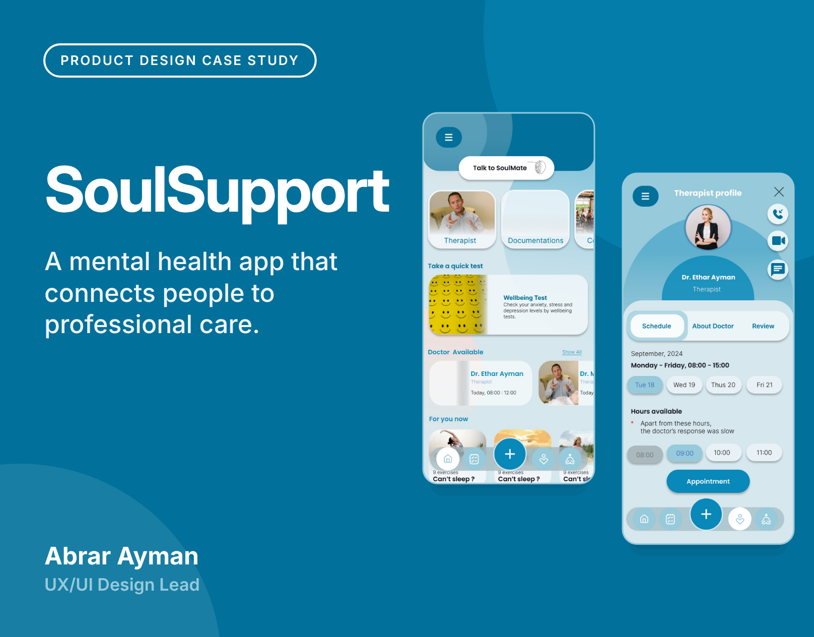
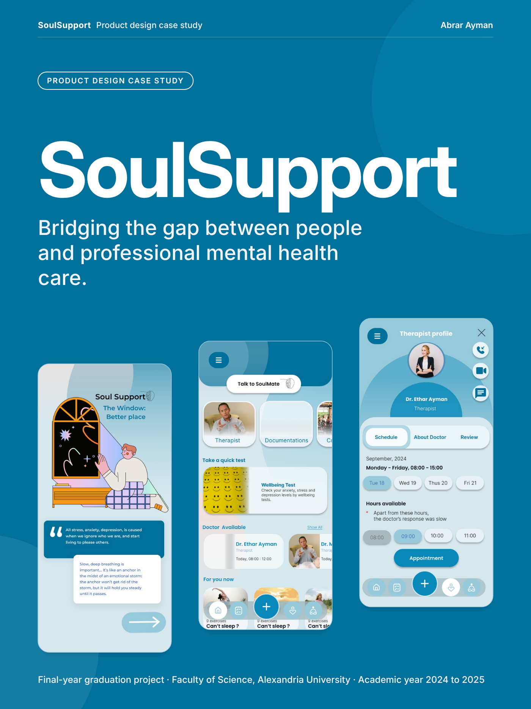
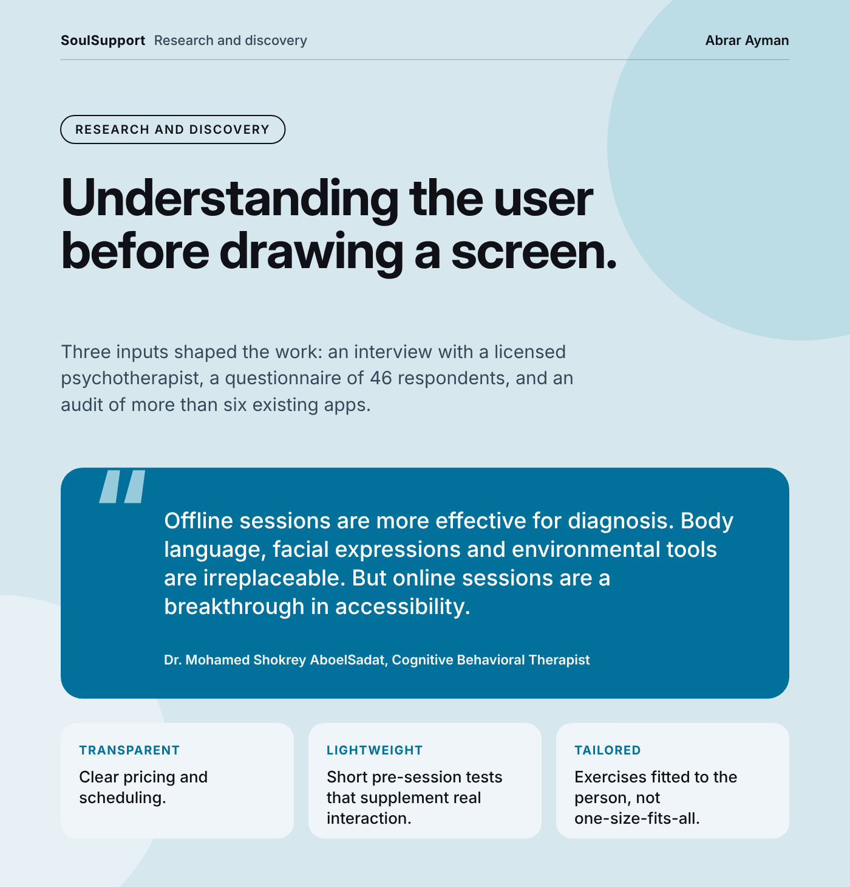
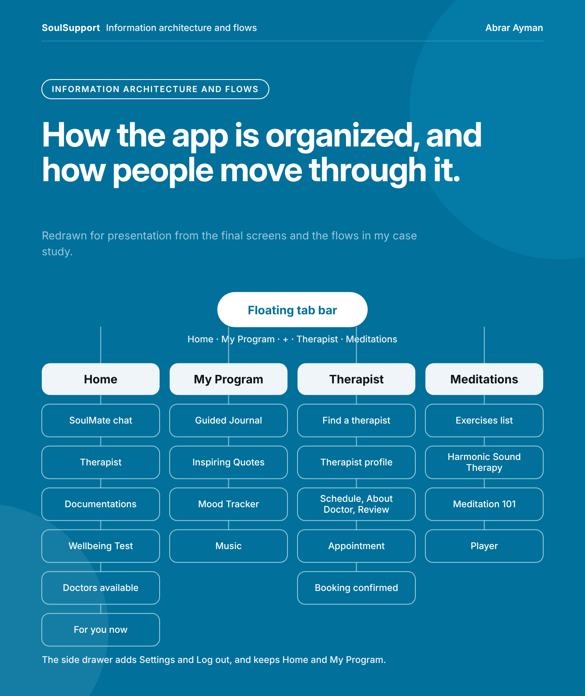
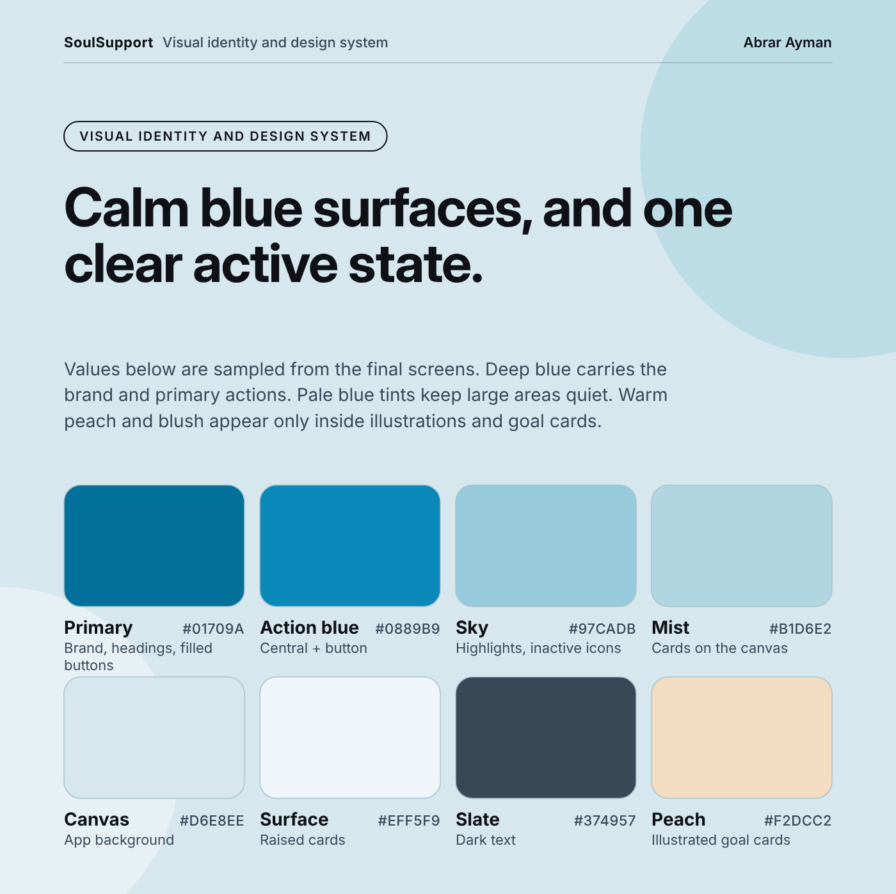
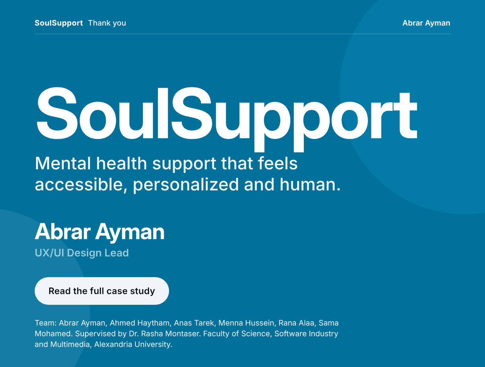

 

A UX/UI design case study exploring how a connected digital experience can make mental wellness resources, self-reflection tools, and professional support easier to navigate.

 

&nbsp;&nbsp;

  

<a href="#overview">Overview</a> · <a href="#the-challenge">Challenge</a> · <a href="#design-process">Process</a> · <a href="#the-product-concept">Concept</a> · <a href="#interface-showcase">Showcase</a> · <a href="#design-principles">Principles</a> · <a href="#key-learnings">Learnings</a> · <a href="#project-resources">Resources</a>

## Overview

SoulSupport is a mental wellness platform concept developed as part of an academic graduation project. It explores how digital product design can bring different wellbeing resources and support options together in a more approachable, coherent experience.

Rather than treating mental wellness as a collection of disconnected features, the project considers how users discover, understand, and navigate different forms of support.

### Project at a Glance

| Category | Details |
| --- | --- |
| 🎯 Role | UX/UI Design Lead |
| 🎓 Project type | Academic graduation project |
| 🧠 Domain | Digital mental wellness |
| 📱 Platform | Mobile application |
| 🎨 Design tool | Figma |
| 👥 Team | Graduation project team |

<!-- Timeline: add the project duration as a new row above, e.g. | ⏱️ Timeline | 3 months | -->

## The Challenge

Mental wellness needs vary from person to person. Finding relevant resources, maintaining self-care habits, and navigating available support options can be challenging when experiences are fragmented or difficult to understand.

The challenge was to explore a digital experience that organizes these needs into a clear and approachable product while considering trust, privacy, accessibility, and responsible communication.

## Design Objectives

| | |
| --- | --- |
| **01 — Understand users** Explore user needs, expectations, behaviors, and pain points through the research methods used in the project. | **02 — Simplify navigation** Organize features into understandable user journeys and make important actions easier to discover. |
| **03 — Create a coherent experience** Establish consistent interaction patterns, clear information hierarchy, and a cohesive visual language. | **04 — Design responsibly** Consider privacy, accessibility, and the limitations of AI-assisted wellbeing support. |

## My Role

As UX/UI Design Lead, my work focused on translating project requirements and user needs into a structured product experience.

My responsibilities included UX research, problem definition, information architecture, user flows, wireframing, interface design, and design evaluation, according to the scope of my contribution.

The project also involved collaboration across the wider graduation-project team.

## Design Process

<b>01. Discover</b>

 

Explore the problem space, review existing solutions, and investigate user needs through the research methods used in the project.

<b>02. Define</b>

 

Synthesize research findings, identify key challenges, and establish opportunities to guide product decisions.

<b>03. Structure</b>

 

Develop the information architecture, organize core features, and map the primary user journeys.

<b>04. Design</b>

 

Translate the proposed experience into wireframes, interface designs, and reusable UI components.

<b>05. Evaluate</b>

 

Review the experience through usability evaluation, identify areas of friction, and refine the design where supported by findings.

## The Product Concept

SoulSupport explores several interconnected areas of digital wellbeing.

<b>Read the feature details as a table</b>

 

| Feature | Purpose |
| --- | --- |
| AI-Assisted Support | Explore conversational assistance for general wellbeing-related guidance. |
| Mood Tracking | Support self-reflection and awareness of emotional patterns. |
| Personalized Wellbeing | Surface relevant activities and resources based on user needs. |
| Professional Support | Explore access to therapists and appointment booking. |
| Wellbeing Resources | Organize educational content and practical exercises. |
| Community & Connection | Explore ways to help users feel connected and supported. |

> These represent conceptual areas of the project; the final scope and implementation status should be understood in the context of the completed design.

## Interface Showcase

Use this section to present selected screens from the actual Figma design. Prioritize screens that communicate the product's visual identity, information architecture, and most important user journeys.

  

  

<h3 align="center">Project Gallery</h3>

  
  
  

  
  

## Design Principles

<b>💡 Clarity</b>

 

Make information and actions understandable without unnecessary complexity.

<b>🤝 Empathy</b>

 

Use supportive, respectful interactions without making assumptions about individual experiences.

<b>🔒 Trust</b>

 

Consider transparency, privacy, and clear boundaries around AI-assisted functionality.

<b>🧩 Consistency</b>

 

Establish predictable interactions and reusable components across the product.

<b>♿ Accessibility</b>

 

Consider readability, understandable navigation, and diverse user needs throughout the experience.

## Research & Validation

Research and evaluation should inform design decisions rather than simply document the process.

The completed project materials should detail the research methods used, the most significant findings, and how those findings influenced the final experience.

Where usability testing was conducted, distinguish observed findings from proposed improvements and report outcomes only when supported by evidence.

## Key Learnings

SoulSupport provided an opportunity to explore how research, product structure, interaction design, and visual consistency work together in a sensitive product domain.

The project reinforced the importance of connecting design decisions to user needs, balancing feature breadth with simplicity, and considering trust and safety from the beginning of the design process.

## Future Opportunities

<b>Further work could explore</b>

 

- Accessibility evaluation across diverse user needs.
- Additional user scenarios and usability testing.
- The effectiveness of personalized experiences.
- Privacy requirements and responsible boundaries for AI-assisted features.
- Clearer pathways between self-guided resources and professional support.

## Project Resources

- 📖 **Full case study:** [Explore the project](https://abrarayman27.github.io/soulsupport-ux-case-study/)
- 🎨 **Figma prototype:** [View the design](https://www.figma.com/proto/sr5rklT5eEoCt0taP5sclI/Soul-Support-App?node-id=11-1459&viewport=-477%2C682%2C0.09&t=SlLwomeVop0m6pnj-1&scaling=scale-down&content-scaling=fixed&starting-point-node-id=1459%3A2311&page-id=0%3A1)
<!-- - 🎤 **Project presentation:** [View presentation](YOUR_PRESENTATION_LINK) -->

## About the Designer

**Abrar Ayman**  
Product Designer · UI/UX Designer

Interested in designing thoughtful digital experiences through research, structured problem-solving, and human-centered interaction design.

[LinkedIn](https://linkedin.com/in/abrar-ayman-9ba724222) · [Behance](https://www.behance.net/abrarayman2) · [GitHub](https://github.com/abrarayman27)

 

Disclaimer: SoulSupport is an academic design project. Its concepts are not a substitute for professional mental healthcare, diagnosis, or treatment.
